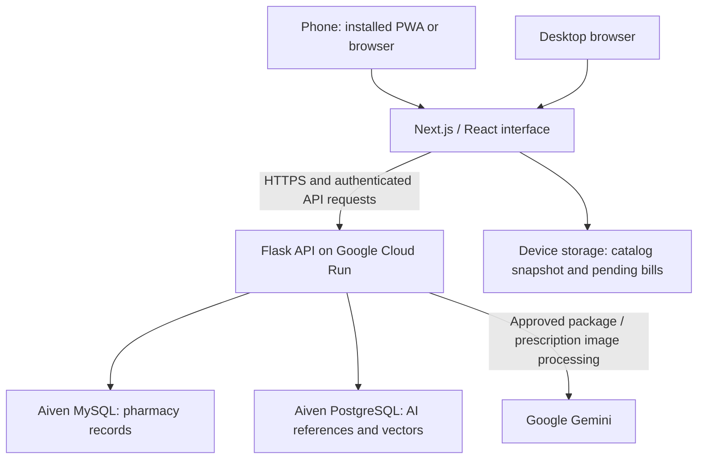
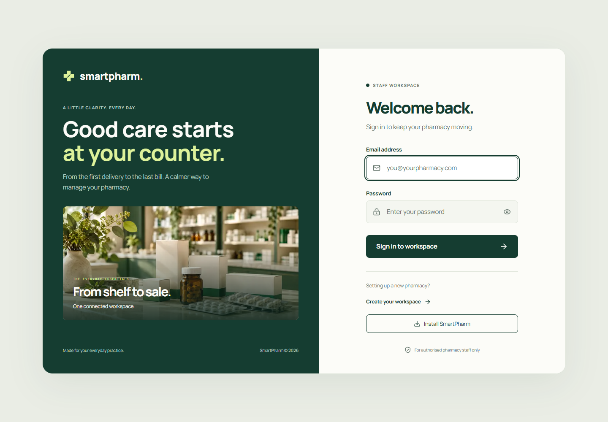
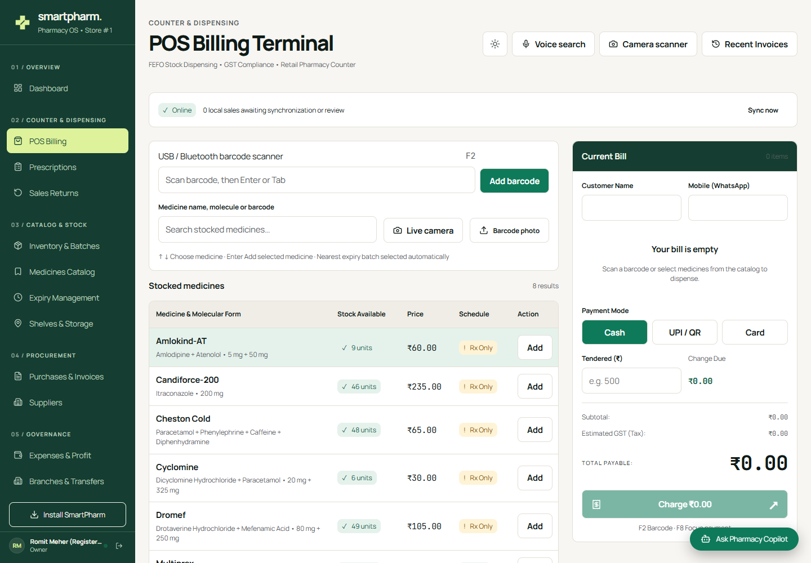

# SmartPharm

> **Copyright and academic integrity notice**
> Copyright © 2026 Romit Meher and contributors. All rights reserved.
> This repository is public for college assessment and portfolio review. Public visibility does not grant a license to reuse this project's original code, designs, or documentation. Do not submit this work as your own, redistribute it, or use it in another project without prior written permission from the relevant copyright holders. See [COPYRIGHT.md](COPYRIGHT.md) for details and third-party exceptions.

Pharmacy management for Indian physical pharmacies, with an installable mobile web app, barcode billing, assisted medicine-package recognition and batch-based inventory. Built with Next.js 16, React 19 and TypeScript on the frontend, and Flask / SQLAlchemy on the backend.

**[Open SmartPharm](https://smartpharm-web-244760124290.asia-south1.run.app/login)** · [Cloud deployment guide](deploy/gcp/README.md) · [Copyright and permitted review](COPYRIGHT.md)

The hosted application requires a staff account. Demo credentials are provided separately and are not published in this repository. Service availability and external AI quotas can change.

## Architecture



The deployed app and the interactive local installation use Aiven MySQL for business records and Aiven PostgreSQL for AI/reference persistence. SQLite is used by isolated automated tests and selected local evaluation tools; it is not a third database for the deployed pharmacy.

## Interface preview

Recorded project screenshots; the current deployment may include newer changes.





## Connected workflows

- First-store setup, login, owner/manager/pharmacist/cashier/inventory roles.
- Team & Access for staff creation, role assignment, password resets and activation, with owner/self protection and audit history.
- Medicines, ingredients and aliases, batches, shelf stock, expiry and audited adjustments.
- POS billing, FEFO selection, customers, receipts, sales history, partial and full returns.
- Purchase drafts, review and acceptance, suppliers, invoice parsing and editable physical delivery counts passed into actual stock booking.
- Prescription capture, OCR assistance, clinical verification and dispensing records.
- Shelf layout, picking locations, storage checks, cycle counts and audit history.
- Expenses, filtered history and operational profit/loss workspace.
- Owner branch creation with initial manager account, cross-branch stock, transfer draft, dispatch and receipt.
- Durable offline POS queue, cached catalog, pending/conflict status, reconnect retry and manager reconciliation.
- Grounded copilot, demand/stockout/expiry/reorder calculations and browser speech-to-search.
- Installable PWA with camera support, offline fallback, and update prompts that avoid interrupting an active bill.

## Mobile installation

SmartPharm is a **Progressive Web App**, using the same account, backend and pharmacy records as the website. It is not a separate Android APK or iOS application.

- **Android / supported desktop browsers:** open the HTTPS website and use **Install SmartPharm** or the browser's installation menu, where available.
- **iPhone / iPad:** open the website in Safari, choose **Share → Add to Home Screen**, then confirm.
- Grant camera permission when scanning. Installation itself does not grant camera access.

Installation availability depends on the browser and device. Internet is required for new-page navigation, new sign-in, cloud recognition and synchronization. Installing the app does not make every feature available offline.

## Demo walkthrough

1. Sign in with the separately supplied demo account and review the dashboard.
2. Open **Inventory & Batches** to inspect stock quantities, batch numbers and expiry dates.
3. Open **POS Billing**. Search for a stocked medicine, scan its linked barcode, or upload a photo showing its printed name and composition.
4. Check the returned medicine, formulation and strength against the pack before confirming it. FEFO selects the nearest eligible expiry batch.
5. Complete a demo bill, inspect its receipt/history, and use **Sales Returns** to demonstrate an eligible return.
6. Review purchases, expiry management, expenses and audit history to show the connected workflows.

The current demo catalog contains eight medicines from the paired-photo demonstration. The private source photos, local scan cards and training datasets are not bundled with a fresh clone. Demo transactions change the shared database; use the designated demo store.

## Local setup (Windows PowerShell)

Use Python 3.11 and Node.js 22 LTS. Start the backend and frontend in separate terminals from this project directory.

```powershell
cd backend
py -3.11 -m venv venv
.\venv\Scripts\python.exe -m pip install -r requirements.txt
Copy-Item .env.example .env
# Configure .env with your MySQL connection, PostgreSQL URL,
# application secret and any optional service credentials before starting.
.\venv\Scripts\python.exe run.py
```

Copy environment examples only for a new installation; preserve existing files. Set either a MySQL `DATABASE_URL` or the `DB_*` connection settings in `.env`, including the provider's TLS configuration. Configure `PGVECTOR_URL` for persistent stocking references and AI vectors. Optional integrations need their own credentials.

For a **new empty business database**, run `.\venv\Scripts\python.exe -m flask --app run db upgrade` from `backend` before first use. For an existing database, follow the migration precautions below. Migrations are included: do not run `db init` or generate migrations for a fresh installation.

```powershell
cd frontend
npm ci
Copy-Item .env.example .env.local
npm run dev
```

Open [first-time setup](http://localhost:3000/login/setup), create the pharmacy and owner, then add medicines, shelves, batches and suppliers. Later visits use [Login](http://localhost:3000/login). The default [API health check](http://127.0.0.1:5000/api/health) is on port 5000. Set `NEXT_PUBLIC_API_URL` before building if the API address differs.

## Existing databases

Back up before migrations. The new operational migration supplies ten tables missing from the original history. An installation previously created with `db.create_all()` needs a schema comparison and correct Alembic baseline stamp first; blindly upgrading it can fail on existing tables. No live migration runs automatically.

## Offline counter use

Sign in and open POS online first to cache the catalog. Checkout saves a UUID transaction locally before replaying it. The server commits the sale and sync receipt atomically; retries use the same UUID. Disconnected bills remain pending and reserve cached stock. Conflicts remain visible until a manager reconciles inventory and retries. Reviewing a conflict does not falsely record a sale.

The ledger and cache belong to the signed-in account and store. New offline login is unavailable. Keep this browser profile and site data until every bill is synced. Settings clears only the catalog cache, preserving saved bills and login. Web Locks support is required for same-browser checkout reservations. Multiple disconnected terminals still require server reconciliation.

The catalog snapshot uses IndexedDB; pending sale records use account/store-scoped local storage. These application-managed records are separate from service-worker caching. The service worker caches only selected public resources and serves an offline fallback for unavailable navigation. Authenticated pages, API responses and payment requests are not blindly cached. An already-open POS with a downloaded catalog can support disconnected work; a cold offline launch or reload is not guaranteed to restore POS.

Updates display a notice rather than forcibly reloading an active bill. Finish work and sign out before using the update action; other open app windows can delay activation.

## Optional computer vision and AI

**Barcode scanning:** the browser camera uses ZXing, with exact server-side catalog lookup. Linked identifiers retain leading zeros. Unknown barcodes do not become guessed medicine matches. Keyboard-style barcode scanners can also enter the barcode field.

**Package photos:** exact barcode decoding runs first. With an enabled, configured Google connection, package images can be transcribed and matched against the store's catalog. Ambiguous identity and conflicting strengths are rejected. A successful result still requires pharmacist verification; reading a package is not a dispensing decision.

**Local OCR fallback:** install `backend/requirements-vision.txt` for PaddleOCR and optional package detection. Model weights download on first use; the cloud image includes small OCR weights. Local fallback can be slower and can fail on sideways, reflective, small or unreadable print. Manual search remains available.

**Prescription and invoice capture:** extracted information is a draft for review and correction. Handwriting recognition uses the configured Google integration when selected. Images can contain personal information; use these processing options only with appropriate authorization.

| Setting | Purpose |
| --- | --- |
| `GEMINI_API_KEY` | Backend-only Google credential; never put it in a `NEXT_PUBLIC_*` variable. |
| `PACKAGING_VISION_ENABLED` | Set to `false` to disable Google package-photo processing. |
| `PACKAGING_VISION_MODEL` | Select an available model; the verified deployment uses `gemini-3-flash-preview`. |
| `PRESCRIPTION_VISION_MODEL` | Select the handwriting transcription model. |
| `PGVECTOR_URL` | PostgreSQL connection for persistent reference/vector services. |
| `TAVILY_API_KEY` | Optional stocking web lookup. |
| `SMARTPHARM_DATA_DIR` | Optional local dataset location; datasets are not shipped. |

Google processing requires connectivity and available provider quota. Free-tier limits, temporary failures and unsupported browsers can affect the demo. Recognition results on supplied photos are not a general accuracy benchmark or clinical validation. Text vectors use deterministic hashed features and visual vectors use image features; indexing or training utilities do not establish clinical accuracy.

## Credentials and generated files

Keep real environment files, certificates, account exports, browser profiles and API keys out of Git. Use the supplied environment templates for setup and Secret Manager for deployed credentials. Application authentication and role checks remain required even though the website and API addresses are public.

Temporary browser profiles and raw Lighthouse reports are local verification artifacts. Ignore rules prevent ordinary additions; they do not remove files already committed or erase Git history. GitGuardian checks pushed commits in GitHub Actions. Do not disable detection to make a failed scan pass; investigate and remove the source of each finding.

## Verification

```powershell
cd backend
.\venv\Scripts\python.exe -m pytest -q
```

Tests use temporary SQLite, isolated datasets and disabled external AI/model downloads. Default pytest excludes `test_live_*.py`: those scripts target a real store and are unsuitable for routine production verification. Tests include fresh migration upgrade/downgrade and metadata parity.

```powershell
cd frontend
npm run lint
npm run typecheck
npm test
npm run build
```

GitHub Actions runs both suites, lint, type checking and build. See the [completion blueprint](plans/smartpharm-completion.md) for scope, dependencies, review findings and measured results.

## Deployment and practical limits

Use MySQL for concurrent stores, a strong `SECRET_KEY`, HTTPS, restricted `CORS_ORIGINS`, backups and a production WSGI server. Set `FLASK_ENV=production` and run `venv\Scripts\waitress-serve.exe --listen=127.0.0.1:5000 run:app` behind an HTTPS proxy. Build and start the frontend with `npm run build` then `npm start`. Flask development hosting is for local use.

One installation represents one pharmacy chain with owner oversight; this is not a tenant-isolated SaaS service. Profit/loss excludes GST and reverses costs for restocked goods. Missing purchase costs fall back to 70% of MRP, making reports operational estimates rather than audited accounts. Cash refunds are capped by collected non-credit tender; returned credit goods may require separate debt reconciliation. Some printer/audio preferences are not integrated into every workflow. SQLite tests do not establish real MySQL concurrency/load behavior or real-device OCR accuracy. Hosting, backups, external credentials, credential rotation and regulatory approval remain operator responsibilities.
